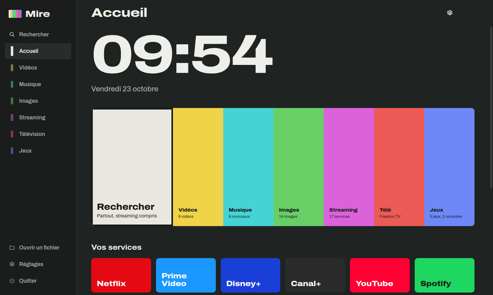

# Mire

[](https://github.com/jezoock/mire/actions/workflows/ci.yml)

Lecteur multimédia et frontend de salon : vos fichiers du disque dur, Netflix, Prime Video, Amazon Music et vos autres sites de streaming affichés directement dans l’application, la télévision de la Freebox, vos jeux PC et vos émulateurs. Une recherche unique couvre toutes ces sources, qui peuvent être des dossiers, des partages réseau ou des serveurs web. Mire va chercher en ligne affiches, genres et fonds d’écran ; chaque média ou jeu se modifie à la main ; sa Boutique installe vos émulateurs en un clic. L’accueil se personnalise, cinq thèmes sont proposés, et tout se pilote au clavier, à la souris ou à la manette.



## Installation

1. Installez [Node.js](https://nodejs.org) (version LTS, 22 ou plus récente).
2. Installez un lecteur externe : [VLC](https://www.videolan.org) ou [mpv](https://mpv.io). Il sert pour la télévision et pour les formats que le lecteur intégré ne lit pas. Mire le détecte tout seul s’il est installé à l’emplacement habituel.
3. Ouvrez un terminal dans ce dossier, puis :

```
npm install
npm start
```

Mire utilise [Electron for Content Security](https://github.com/castlabs/electron-releases) de castLabs, une version d’Electron qui embarque Widevine, la protection exigée par Netflix, Prime Video et Amazon Music. Comme castLabs ne publie pas sur le registre npm, le paquet vient de GitHub. Le fichier `.npmrc` fourni (`allow-git=root`) autorise npm 12 à installer cette seule dépendance, déclarée par le projet lui-même.

Au premier `npm start`, Electron télécharge son moteur (environ 120 Mo), puis Widevine s’installe en arrière-plan. Les lancements suivants sont immédiats.

Si vous remplacez une ancienne version de Mire, supprimez d’abord l’ancien dossier `node_modules`, puis relancez `npm install`. N’utilisez pas `npm audit fix --force` : cette commande force des changements de version majeurs qui peuvent casser l’application.

Pour fabriquer un installateur (un `.exe` sous Windows, un `.dmg` sous macOS, un `.AppImage` sous Linux) :

```
npm run dist
```

L’outil de fabrication (electron-builder) est téléchargé à la demande, uniquement pour cette commande. Il affiche quelques avertissements « deprecated » venant de ses propres dépendances : ils sont sans effet sur l’installateur produit. L’installateur apparaît dans le dossier `dist`.

## Rien n’est installé d’office

À l’installation, Mire est vide : aucun service de streaming, aucun jeu, aucune console, aucune source. Tout s’ajoute ensuite, à la main dans les réglages de chaque page, ou d’un coup en important une configuration (Réglages → Configuration → Importer). Seule exception : la télévision, livrée avec les services existants (voir plus bas).

### Exporter et importer votre configuration

Toute votre installation (sites de streaming, consoles, jeux PC, sources, sites de téléchargement, services de télé) tient dans un seul fichier. Dans **Réglages → Configuration** :

- **Exporter** l’enregistre où vous voulez, pour le sauvegarder ou le réutiliser sur un autre ordinateur.
- **Importer (remplacer)** écrase la configuration actuelle par celle du fichier.
- **Importer (compléter)** ajoute ce qui manque (sites, consoles, jeux, sources) sans rien supprimer de ce que vous avez déjà.

Le fichier est lisible et modifiable à la main ; sa version est convertie automatiquement si elle vient d’une ancienne installation.

## Premier démarrage : vos sources

Dans **Réglages → Sources**, ajoutez autant de sources que vous voulez pour chaque type : **Vidéos**, **Musique**, **Images** et **Jeux PC**. Une même source peut servir à plusieurs types (un dossier qui mélange films et photos, par exemple) : ajoutez-la simplement dans chaque type concerné. Les changements s’appliquent tout de suite, et chaque source affiche le nombre d’éléments trouvés ou la raison d’une erreur.

| Type de source | Exemple | Remarques |
| --- | --- | --- |
| Dossier | `D:\Films`, `/home/moi/Musique` | Sous-dossiers compris. |
| Partage réseau | `\\NAS\Films`, `smb://nas/films` | Sous Windows, les partages se lisent directement (connectez-vous-y une fois dans l’explorateur s’ils demandent un mot de passe). Sous macOS et Linux, montez d’abord le partage (Finder, gestionnaire de fichiers) : Mire le retrouve alors dans `/Volumes` ou dans gvfs. |
| Serveur web | `http://192.168.1.10/films/` | Une page qui liste les fichiers (index d’Apache, nginx, du serveur web d’un NAS…). Mire parcourt aussi les sous-dossiers, et trouve affiches, fonds et sous-titres rangés à côté. |
| Liste de lecture | `http://…/chaines.m3u` | Chaque entrée devient une vidéo ou un morceau. |

Les vidéos et musiques d’un serveur web se lisent directement en streaming, sans téléchargement.

Vous pouvez aussi ouvrir un fichier isolé avec **Ouvrir un fichier** (dans le menu principal), le glisser sur la fenêtre, ou utiliser « Ouvrir avec Mire » dans l’explorateur une fois l’application installée.

## Personnaliser l’accueil et le thème

Tout se règle en haut de **Réglages**, ou avec le rouage de l’en-tête de l’accueil, et s’applique immédiatement.

**Thème** : Écran éteint (le thème d’origine, gris-vert sombre), Plein jour (clair), Minuit (bleu nuit), Velours (brun chaud), Contraste élevé (noir et blanc, anneau de sélection jaune épais, pratique de loin) ou Automatique, qui suit le mode clair ou sombre du système. Chaque carte montre un aperçu réel du thème.

**Page d’accueil** :

- **Au démarrage, ouvrir** : l’accueil, une autre section (Télévision, Rechercher…) ou directement un service (Netflix, YouTube…).
- **L’heure et la date**, et la rangée **Reprendre** : à afficher ou non.
- **Barres de la mire** : cochez celles à garder et changez leur ordre avec les flèches.
- **Services affichés sur l’accueil** : la rangée « Vos services » donne un accès direct à vos plateformes préférées, dans l’ordre de votre choix.

## Menu, en-tête et réglages de chaque page

**Menu principal.** Dans **Réglages → Apparence** (ou le rouage de l’accueil, onglet Menu), choisissez sa position : à gauche ou à droite, c’est une barre latérale ; en haut ou en bas, c’est un carrousel qu’on fait défiler (flèches, molette, ou simplement en s’y déplaçant au clavier ou à la manette : l’élément sélectionné vient au centre). L’option **rétractable** le cache le long d’une fine poignée : il réapparaît quand la souris approche du bord ou quand on y revient avec les flèches, et se replie ensuite. Le menu contient aussi Rechercher, **Ouvrir un fichier**, Réglages et Quitter.

**En-tête.** Chaque page a le même en-tête, de hauteur fixe : son titre, la recherche dans la page quand elle existe, l’heure et un **rouage** qui ouvre les réglages propres à la page et à son type de média :

| Page | Réglages du rouage |
| --- | --- |
| Accueil | page d’accueil, menu |
| Rechercher | clé TMDB, pays, recherches récentes |
| Vidéos, Musique, Images | sources, récupération des infos et images, affichage |
| Streaming | bloqueur de publicités, ajout d’un site |
| Télévision | playlist, qualité, lecteur externe |
| Jeux | consoles (et leurs bannières), Boutique, dossiers de jeux PC, jaquettes |

Ces réglages s’appliquent immédiatement. **Réglages**, dans le menu, rassemble toujours l’ensemble.

## Modifier un média ou un jeu

Chaque vidéo, album, morceau, image, jeu PC ou jeu de console se modifie individuellement : bouton **Modifier** du panneau d’infos (ou de l’album), **clic droit** sur l’élément, touche <kbd>E</kbd> (ou la touche Menu du clavier), ou bouton X de la manette.

On peut y changer le titre, l’année, le genre, le résumé, l’artiste (albums), l’image et le fond d’écran (choisis sur le disque). **Rechercher en ligne** cherche le titre saisi et affiche **toutes les fiches trouvées**, avec leur image, leur année et leur source : choisissez la bonne (par exemple REPLACED plutôt que « The Farmer Was Replaced »). Les plus proches du titre saisi sont en premier, et la récupération automatique applique la même règle. **Réinitialiser** revient aux infos d’origine. Pour un jeu ajouté à la main, on peut aussi modifier le programme et ses arguments.

Vos modifications passent toujours avant les infos récupérées en ligne et ne sont jamais écrasées par une nouvelle récupération. Elles sont rangées dans `meta/meta.json`, dans les données de Mire (les images choisies y sont copiées).

## Genres et fonds d’écran

Chaque type de média ou de jeu a un **genre** : récupéré en ligne (TMDB pour les films et séries, MusicBrainz pour les albums, libretro pour les jeux de console, Steam pour les jeux PC) ou saisi à la main (plusieurs genres séparés par des virgules). Une rangée de filtres par genre apparaît en tête des Vidéos, de la Musique, des Images, des Jeux PC et des jeux de chaque console.

Quand vous sélectionnez ou survolez un élément d’une liste, son **fond d’écran** s’affiche en arrière-plan, atténué : image de fond du film (TMDB), bannière du jeu (Steam), capture d’écran du jeu de console (libretro), pochette agrandie pour la musique, ou l’image elle-même dans Images. Un fichier `fanart.jpg` dans un dossier, ou `film-fanart.jpg` à côté d’un film, sert de fond en priorité. On peut désactiver le fond dans **Réglages → Affichage**.

## Infos et affiches

Après chaque analyse de la bibliothèque, Mire cherche en ligne une image et quelques infos pour ce qui n’en a pas encore. Le rouage en haut à droite des sections Vidéos, Musique et Jeux ouvre les réglages de la page, dont **Récupérer les infos** pour relancer la recherche. Pendant une récupération, le rouage tourne et son infobulle indique l’avancement.

| Contenu | Ce qui est récupéré | Source | Clé nécessaire |
| --- | --- | --- | --- |
| Films | Affiche, titre, année, genre, résumé, fond | TMDB | Oui, gratuite (voir « Clé TMDB ») |
| Séries | Affiche, genre, résumé et fond de la série, pour tous ses épisodes | TMDB | Oui, la même |
| Albums | Pochette, artiste, année, genre | MusicBrainz et Cover Art Archive | Non |
| Jeux de console | Jaquette, nom propre, genre, année, capture d’écran en fond | libretro (jaquettes et base de données de RetroArch) | Non |
| Jeux PC | Jaquette, genre, année, résumé, fond | Magasin Steam | Non |

Mire reconnaît les noms de fichiers courants : `Intouchables (2011).mkv`, `Le.Fabuleux.Destin.2001.1080p.BluRay.mkv`, `S01E03.mkv` rangé dans `Le Bureau des légendes/Saison 1`. Pour les jeux de console, les noms au format No-Intro (`Super Mario World (Europe).sfc`) donnent les meilleurs résultats ; Mire tolère aussi les noms approximatifs.

En tête des Vidéos, un panneau affiche le titre, l’année et le résumé de la vidéo sélectionnée. Si Mire s’est trompé de film, **Corriger** permet d’indiquer le bon titre (et l’année).

Les fiches récupérées avant cette version sont complétées automatiquement (genre, fond) à la prochaine récupération. Les images sont stockées dans les données de Mire : rien n’est écrit dans vos dossiers. Une image que vous placez vous-même à côté d’un fichier (`film.jpg`, `cover.jpg`…) reste toujours prioritaire. Un titre introuvable est retenté au bout de quinze jours. Dans **Réglages → Infos et affiches** : désactiver la récupération automatique, tout récupérer à nouveau, ou tout effacer.

## Vidéos : films et séries

La page Vidéos présente les films et les séries. Les épisodes d’une même série sont réunis sous une seule affiche : on l’ouvre pour voir ses **saisons**, puis une saison pour voir ses **épisodes** (série → saison → épisode). Mire reconnaît les séries d’après les noms de fichiers (S01E03, 1x03…) et, pour un marque-page de streaming, d’après la saison et l’épisode que vous indiquez à l’ajout.

La **source** d’une vidéo (un dossier, un serveur, le streaming) n’est plus affichée en permanence : c’est devenu un critère. Dans l’en-tête, à côté de la recherche, des icônes ouvrent des menus : **filtrer** par source, **trier** (par titre, par année, ou en regroupant par source). Un menu **source de recherche**, près du champ de recherche, restreint la recherche à une source précise (un dossier, un serveur, le streaming) ; il apparaît dans toutes les sections dès qu’il y a plusieurs sources.

## Fichiers du disque dur

Le lecteur intégré lit directement les MP4, MKV, WebM et MOV (H.264, VP9, AV1, et H.265 si la carte graphique le décode), les MP3, FLAC, WAV, OGG, Opus et M4A, ainsi que les images JPG, PNG, GIF, WebP et AVIF.

Les autres formats (AVI, WMV, FLV, MPG, TS, WMA…) s’ouvrent automatiquement dans VLC ou mpv. Si un fichier refuse de se lire dans Mire, il bascule aussi vers le lecteur externe. Quand une vidéo n’a pas de son (piste AC3 ou DTS, fréquente dans les MKV de films), Mire le signale et propose de continuer dans le lecteur externe à la même position.

Quelques conventions de rangement que Mire comprend :

- **Affiches** : `Film.jpg` ou `Film-poster.jpg` à côté de `Film.mkv`, ou `poster.jpg` dans le dossier.
- **Pochettes d’album** : `cover.jpg` ou `folder.jpg` dans le dossier de l’album. Un dossier nommé `Artiste - Album` est affiché avec l’album en titre et l’artiste en dessous.
- **Séries** : un dossier `Saison 1` est présenté avec le nom de la série (le dossier parent).
- **Sous-titres** : `Film.srt`, `Film.fr.srt` ou `Film.en.srt` à côté de la vidéo. Les sous-titres français s’activent d’office, la touche <kbd>S</kbd> passe de l’un à l’autre. Les vieux `.srt` encodés en Windows-1252 s’affichent correctement.
- **Reprise** : Mire retient où vous vous êtes arrêté dans les vidéos de plus de cinq minutes.

## Streaming dans Mire

Services proposés d’office, rangés par catégorie dans la section Streaming :

- **Films et séries** : Netflix, Prime Video, Disney+, Canal+, HBO Max, Apple TV, Paramount+, Crunchyroll, YouTube, france.tv.
- **Musique** : Amazon Music, Spotify, Deezer.
- **Autres sites** : JustStream, Voir-Anime et ceux que vous ajoutez.

Tous les sites s’ouvrent à l’intérieur de Mire, sans navigateur. Une barre en haut de la page donne, sous forme d’icônes, le retour, la page suivante, le rechargement, le plein écran et la fermeture. Les sites ouverts apparaissent sous « Streaming » dans la barre latérale : vous passez de Netflix à votre musique ou à la télé, puis vous revenez exactement où vous en étiez. En quittant un site, ses vidéos se mettent en pause ; Amazon Music, lui, continue de jouer en fond (option `background`).

Chaque site garde vos connexions d’une fois sur l’autre, ne peut pas ouvrir de fenêtres surgissantes et n’a aucun accès à vos fichiers.

Les vérifications « Vérifiez que vous êtes humain » de Cloudflare fonctionnent dans Mire : l’application présente partout la même identité de navigateur, y compris dans le cadre de vérification. Si un site refuse malgré tout de fonctionner, le bouton **Navigateur** de la barre du haut ouvre la page en cours dans votre navigateur habituel.

Raccourcis dans un site : <kbd>F11</kbd> plein écran, <kbd>Échap</kbd> pour en sortir, <kbd>F9</kbd> revenir aux menus de Mire, <kbd>Alt</kbd>+<kbd>←</kbd> page précédente (ou le bouton « précédent » de la souris), <kbd>F5</kbd> recharger, <kbd>Ctrl</kbd>+<kbd>W</kbd> fermer le site.

### Mettre une page en marque-page (vidéos)

Sur un site de streaming, le bouton **étoile** de la barre du haut ajoute la page affichée à vos **Vidéos**. Une fenêtre demande un titre (prérempli depuis le titre de la page), le type (**film** ou **série**) et, pour une série, la saison et l’épisode. Mire crée alors une entrée vidéo et **récupère aussitôt ses infos** (affiche, résumé, genres) depuis TMDB, selon le titre et le type choisis.

Cette entrée apparaît parmi vos films ou vos séries, avec sa jaquette. L’ouvrir rouvre la page du site dans la vue intégrée (ce n’est pas un fichier local). Vous la modifiez (titre, fiche) ou la supprimez comme toute autre vidéo.

### Se connecter à Google (YouTube, Gmail…)

Google refuse la connexion depuis les navigateurs intégrés aux applications quand ils se présentent comme Chrome (« Ce navigateur ou cette application ne sont peut-être pas sécurisés »), mais l’accepte quand ils donnent leur vraie identité. Mire se présente donc avec son identité d’origine (Electron) sur la seule page de connexion Google, `accounts.google.com`, et partout ailleurs comme Chrome (ce qui est nécessaire, entre autres, aux vérifications Cloudflare). Une fois connecté, vous restez connecté à YouTube d’une fois sur l’autre.

Google peut changer ses règles à tout moment. Si la connexion était de nouveau refusée, le bouton **Navigateur** (globe) de la barre du site permet de vous connecter et de regarder YouTube dans votre navigateur habituel en attendant une mise à jour de Mire.

### Bloqueur de publicités

Les sites ouverts dans Mire passent par un bloqueur de publicités (le moteur open source de Ghostery), avec les listes d’Adblock Plus (EasyList, EasyPrivacy, Liste FR) et celles d’uBlock Origin. Il bloque :

- les publicités et les traqueurs, avant même leur téléchargement ;
- les blocs de pub intégrés aux pages, et les cases vides laissées par les publicités bloquées ;
- les fenêtres surgissantes ;
- les redirections publicitaires (« je clique sur la vidéo et j’atterris sur une page de pub ») : la page reste en place et un court message l’indique.

Comme uBlock Origin, le bloqueur exécute aussi de petits scripts correcteurs sur certains sites (sur YouTube, ils retirent les publicités des données du lecteur). Mire les lance au tout début de chaque page, avant le code du site, chacun isolé des autres : c’est indispensable pour que les vidéos YouTube se lisent normalement, sans pub.

Dans la barre du site, l’icône **bouclier** porte le nombre d’éléments bloqués sur la page. Un appui sur le bouclier désactive le bloqueur sur ce site, s’il empêche une page de fonctionner ; un nouvel appui le réactive. Dans **Réglages → Bloqueur de publicités** : tout activer ou désactiver, voir la date de mise à jour des listes, les mettre à jour, gérer les sites exemptés et ajouter des listes de filtres au format Adblock Plus ou uBlock.

Les listes sont téléchargées au premier lancement (quelques secondes), gardées en mémoire, puis mises à jour tous les quatre jours.

### Services protégés : la signature Widevine

Netflix, Prime Video, Disney+, Canal+, HBO Max, Apple TV, Paramount+, Crunchyroll, Amazon Music et Spotify protègent leurs contenus. Ces services refusent de lire leurs vidéos dans une application qui n’est pas reconnue par Google. Sous **Windows et macOS**, il faut donc faire signer Mire une fois par le service gratuit EVS de castLabs. Sous **Linux**, rien à faire.

Il faut [Python 3](https://www.python.org) (sous Windows, cochez « Add python.exe to PATH » pendant l’installation). Ensuite :

```
npm run drm:compte
npm run drm:signer
```

La première commande crée votre compte EVS : nom, adresse e-mail, mot de passe, puis un code de confirmation reçu par e-mail. La seconde signe le moteur utilisé par `npm start`. Relancez ensuite Mire.

À refaire après chaque mise à jour d’Electron (la commande `drm:signer` suffit). Si EVS redemande vos identifiants, lancez `npm run drm:connexion`. Pour l’installateur, `npm run dist` signe automatiquement l’application fabriquée.

**Limites** : la qualité d’image est celle d’un navigateur comme Chrome, souvent plafonnée par Netflix en dessous de ce qu’offre son application officielle. Les services peuvent aussi changer leurs règles et refuser un jour ce type de lecteur. Si un service ne fonctionne plus dans Mire, passez son `mode` à `"browser"` dans Réglages : il s’ouvrira dans Edge ou Chrome en attendant.

### Ajouter ou corriger un site

Modifiez la liste `web` dans **Réglages → Sites, jeux et consoles** :

```json
{ "name": "Arte", "url": "https://www.arte.tv/fr/", "search": "https://www.arte.tv/fr/search/?q={q}", "color": "#FA481C" }
```

- `url` : la page d’accueil du site.
- `search` : l’adresse de recherche, où `{q}` est remplacé par les mots cherchés. Vous n’avez pas besoin de la trouver vous-même (voir ci-dessous).
- `color` : la couleur de la tuile.
- `background: true` : la lecture continue quand vous quittez le site.
- `mode: "browser"` : ouverture dans le navigateur externe, en secours.

Si un site change d’adresse, modifiez simplement son `url`.

## Rechercher partout

L’entrée **Rechercher** du menu principal (ou la touche <kbd>/</kbd>, ou la barre blanche de l’accueil) ouvre une recherche unique. Les résultats se rangent par source :

- **Vos vidéos, votre musique, vos images** : noms de fichiers et de dossiers.
- **Films et séries en streaming** : les titres correspondants avec, pour chacun, les services où il est disponible en abonnement. Choisir un titre ouvre directement la recherche de ce titre sur votre service. Cette partie demande une clé gratuite TMDB (voir plus bas).
- **Chercher sur vos sites** : une tuile par site, qui ouvre ses résultats pour les mots tapés.
- **Télévision** : les chaînes de la Freebox.
- **Jeux** : vos jeux PC et les jeux de toutes vos consoles.

Les dernières recherches restent proposées quand le champ est vide.

### Apprendre à Mire la recherche d’un site

La recherche est déjà configurée pour Netflix, Prime Video, Apple TV, Crunchyroll, YouTube, Amazon Music, Spotify et Deezer. Pour Disney+, Canal+, HBO Max, Paramount+, france.tv, JustStream, Voir-Anime ou tout autre site :

1. Ouvrez le site dans Mire.
2. Utilisez le moteur de recherche du site pour chercher le mot **mire**.
3. Appuyez sur l’icône **loupe** (« Mémoriser la recherche ») dans la barre du haut.

Mire relève l’adresse des résultats et saura désormais chercher sur ce site. Si l’adresse de recherche d’un service change un jour, refaites simplement ces trois étapes.

### Clé TMDB pour les films et séries

[TMDB](https://www.themoviedb.org) est une base de films gratuite ; les informations de disponibilité viennent de JustWatch.

1. Créez un compte sur themoviedb.org.
2. Dans Paramètres, rubrique API, demandez une clé (usage personnel).
3. Copiez le « jeton d’accès en lecture à l’API » et collez-le dans **Réglages → Recherche dans les catalogues de streaming**. L’ancienne « clé API » courte fonctionne aussi.

Choisissez le pays des disponibilités dans le même bloc (France par défaut).

## Télévision

Mire est livré avec les services qui permettent de regarder la télévision sur ordinateur : **Freebox TV** et **Orange TV** (listes de chaînes M3U lues dans Mire), **SFR TV**, **B.tv (Bouygues)** et **Molotov** (portails ouverts dans la vue intégrée). Ce sont les seuls services présents d’office.

**Détection automatique.** Au premier lancement, Mire interroge brièvement les box sur votre réseau local et choisit le service correspondant. Vous pouvez aussi le choisir à la main : un menu **Service** dans l’en-tête de la page Télévision, à côté de la recherche, ou la liste complète dans le rouage de la page (avec un bouton « Détecter ma box »).

Pour un service par liste M3U, les chaînes s’ouvrent dans le lecteur externe (mpv ou VLC) et ne sont accessibles que depuis le réseau de la box. L’adresse de la playlist se règle dans le rouage de la page. Certaines chaînes ne sont diffusées que sur le décodeur et ne se lancent pas sur ordinateur.

## Jeux et émulateurs

La section Jeux montre vos jeux PC et vos consoles. En haut de la page, l’espace laissé libre affiche la bannière du jeu ou de la console sélectionnés. La **Boutique** se trouve dans les réglages de la page (rouage en haut à droite), avec les consoles, les dossiers de jeux PC et la récupération des jaquettes.

### Boutique

**Émulateurs.** Un clic télécharge l’émulateur depuis sa source officielle (dernière version publiée), l’installe dans les données de Mire et crée la console correspondante, avec son dossier de jeux (par défaut `Documents/Mire/ROMs/<Console>`, modifiable en haut de la Boutique). « Mettre à jour » réinstalle la dernière version ; « Désinstaller » retire l’émulateur sans toucher à vos jeux.

| Émulateur | Consoles | Windows | Linux |
| --- | --- | --- | --- |
| RetroArch | NES, Super Nintendo, Game Boy, Game Boy Color, Game Boy Advance, Nintendo 64, Mega Drive, Master System, Game Gear, PC Engine | Oui | Oui |
| DuckStation | PlayStation | Oui | Oui |
| PCSX2 | PlayStation 2 | Oui | Oui |
| PPSSPP | PSP | Oui | Oui |
| Dolphin | GameCube, Wii | Oui | Non (utilisez le Flatpak officiel) |
| melonDS | Nintendo DS | Oui | Oui |
| Azahar | Nintendo 3DS | Oui | Non |
| Cemu | Wii U | Oui | Oui |

Pour RetroArch, cochez les consoles voulues puis « Ajouter » : Mire installe RetroArch une fois, puis le module (« cœur ») de chaque console. Sous macOS, la Boutique n’installe rien : installez les émulateurs depuis leur site et déclarez-les dans Réglages.

À savoir : DuckStation et PCSX2 demandent le BIOS de votre propre console (un fichier à copier dans leur dossier « bios ») ; Dolphin a besoin, sous Windows, du « Visual C++ Redistributable » de Microsoft.

**Jeux libres.** Des jeux récents écrits pour ces consoles et distribués gratuitement par leurs auteurs : Nova the Squirrel, Thwaite et Concentration Room (NES), Libbet and the Magic Floor (Game Boy), µCity (Game Boy Color), Cave Story en français (Mega Drive). Ils se téléchargent depuis les dépôts officiels de leurs auteurs, directement dans le dossier de la console.

**Vos propres jeux.** Choisissez une console puis vos fichiers : Mire les copie dans son dossier. C’est le moyen d’ajouter vos sauvegardes personnelles de cartouches et de disques ; la Boutique ne propose pas de jeux du commerce, dont le téléchargement n’est légal qu’à partir de vos propres exemplaires.

### BIOS

Certains émulateurs demandent le BIOS de la console d’origine (PlayStation, PlayStation 2…), d’autres en tirent parti sans l’exiger. Dans la Boutique (rouage de la page Jeux, onglet Boutique), la carte de chaque émulateur installé indique les fichiers attendus, ceux déjà présents et le dossier où l’émulateur les cherche. **Charger un BIOS…** y copie les fichiers choisis sur votre disque, **Ouvrir le dossier** l’ouvre. Mire ne fournit aucun BIOS : utilisez ceux de vos propres consoles.

### Jeux PC

Le plus simple : ajoutez dans **Réglages → Sources → Jeux PC** le ou les dossiers qui contiennent vos jeux (un dossier par jeu, ou des raccourcis). Mire liste tout seul un jeu par raccourci (`.lnk`, `.url`, `.desktop`) ou par sous-dossier, en choisissant le bon programme et en ignorant les désinstalleurs et utilitaires. Ces jeux apparaissent à côté de ceux ajoutés à la main, avec la mention « trouvé dans vos dossiers ».

Dans **Jeux**, la tuile **Ajouter un jeu** accepte un `.exe`, un raccourci `.lnk` ou un raccourci `.url` (ceux que Steam, Epic ou GOG créent sur le bureau). Pendant la partie, Mire se réduit et revient au premier plan quand le jeu se ferme.

Dans la liste JSON, chaque jeu peut avoir une jaquette et des arguments :

```json
{ "name": "Hades", "path": "C:\\Jeux\\Hades\\x64\\Hades.exe", "args": [], "image": "D:\\Jaquettes\\hades.jpg" }
```

Un jeu Steam se lance aussi par son adresse : `"path": "steam://rungameid/1145360"` (le numéro figure dans l’adresse de la page du jeu sur le magasin Steam).

### Une seule liste de jeux, filtrable par système

La page Jeux réunit dans une même liste vos jeux PC et les jeux de console présents sur l’ordinateur. Deux menus déroulants dans l’en-tête, à côté de la recherche, filtrent par **système** (Jeux PC, ou l’une de vos consoles) et par **genre**. Une icône de téléchargement, dans ce même en-tête, ouvre les sites de téléchargement (ceux de la console ouverte, ou ceux des jeux PC). Les consoles sont ainsi traitées comme les jeux PC.

Par défaut, la liste ne montre que les jeux présents **sur l’ordinateur**. Pour voir les jeux d’une source en ligne, ouvrez la console (son nom dans le filtre n’y mène pas : utilisez la vignette de la console, ou « Ajouter des jeux »)… ou plus simplement ouvrez la console depuis sa page et appuyez sur **Afficher les jeux en ligne**. Une option, dans le rouage de la page (onglet Entretien), affiche les jeux en ligne d’emblée à l’ouverture d’une console.

### Supprimer un jeu, nettoyer la liste

Le panneau d’un jeu présent sur l’ordinateur (jeu PC ajouté à la main, ou jeu de console local) porte un bouton **Supprimer** ; la touche <kbd>Suppr</kbd> fait de même sur le jeu sélectionné. Un jeu de console supprimé voit son fichier effacé ; un jeu PC ajouté à la main est retiré de la liste.

Le rouage de la page Jeux, onglet **Entretien**, propose un **nettoyage** : Mire vérifie que chaque jeu est toujours là (fichiers locaux présents, et sources en ligne joignables si vous le demandez) et retire les jeux PC dont le fichier a disparu.

### Jeux sur l’ordinateur et jeux en ligne

La liste des jeux d’une console est séparée en deux : **Sur cet ordinateur** (ses dossiers et partages réseau) et **Disponibles en ligne** (ses sources web). Un jeu en ligne se lance d’un appui (il est alors gardé en cache) ; le bouton **Télécharger sur cet ordinateur** en fait une copie dans le dossier principal de la console, et **Tout télécharger** le fait pour toute la section. Un jeu déjà téléchargé n’apparaît plus dans la section en ligne.

### Jeux sur disque (PlayStation, Saturn, Mega-CD, Dreamcast…)

Un jeu sur disque se lance par un petit fichier d’index qui renvoie aux vrais fichiers de données : un `.cue` cite ses pistes `.bin`, un `.gdi` (Dreamcast) ses pistes, une liste `.m3u` les disques d’un jeu qui en a plusieurs ; un `.ccd` va avec son `.img` et son `.sub`, un `.mds` avec son `.mdf`. Mire lit ces index et télécharge **tous** les fichiers nécessaires :

- pour lancer un jeu en ligne, tout le jeu va dans le cache, dans un dossier à son nom, avant le lancement ;
- « Télécharger sur cet ordinateur » (et « Tout télécharger ») copie l’index et tous ses fichiers dans un dossier au nom du jeu, dans le dossier principal de la console ; un seul message annonce le jeu quand tout est arrivé ;
- un index téléchargé seul depuis un site (« Ajouter des jeux ») fait venir, du même site, les fichiers qu’il cite et qui manquent.

Dans la liste des jeux, un jeu à plusieurs disques n’apparaît qu’une fois, par sa liste `.m3u`. Les noms cités par un index sont contrôlés : un chemin qui sortirait du dossier du jeu est ignoré.

### Ajouter des jeux à une console

Dans la liste des jeux d’une console, le bouton **Ajouter des jeux** (à côté de « Modifier la console ») ouvre un navigateur intégré, comme pour les services de streaming. Dans sa barre du haut :

- un menu déroulant **Site** pour passer d’un site à l’autre parmi ceux de la console ;
- un champ **Chercher sur…** qui lance la recherche sur le site choisi ;
- les icônes habituelles : la **loupe** pour apprendre à Mire la recherche d’un site (cherchez le mot « mire » sur le site, puis appuyez dessus), le bouclier du bloqueur de publicités, le plein écran, le navigateur habituel et la fermeture.

Ce que vous téléchargez depuis ce navigateur (fichiers, liens magnet ou fichiers .torrent) passe par le gestionnaire de téléchargements et va directement dans le **dossier principal de la console**.

Depuis ce navigateur, le bouton **étoile** met un jeu en marque-page sans le télécharger tout de suite : indiquez le titre et le lien (la fiche de la page, un lien de téléchargement direct ou un lien magnet). Mire en cherche les infos (ce qui donne souvent le système ; sinon il le demande, la console ouverte étant proposée par défaut). Le jeu apparaît alors dans la liste des jeux avec une pastille « À télécharger » et, dans son panneau, un bouton **Télécharger**. Il figure aussi dans les **Téléchargements** avec le statut « En attente de téléchargement » et un bouton pour le lancer. Rien ne se télécharge tant que vous ne l’avez pas demandé. Une archive `.zip` ou `.7z` que l’émulateur ne sait pas lire est décompressée dans un sous-dossier ; sinon elle est gardée telle quelle. Le jeu apparaît ensuite dans la liste de la console. Quand vous cherchez un titre dans cette liste, Mire propose aussi de le chercher sur chacun des sites de la console.

Les sites proposés d’office distribuent des jeux légalement (homebrew, domaine public, jeux récents créés pour ces consoles) :

| Consoles | Sites proposés |
| --- | --- |
| Game Boy, Game Boy Color, Game Boy Advance, NES | Homebrew Hub, PDRoms, itch.io |
| Super Nintendo, Nintendo 64, Mega Drive, Master System, Game Gear, PC Engine, Atari 2600 | PDRoms, itch.io |
| PlayStation, PlayStation 2, PSP, Saturn, Dreamcast, Wii | PDRoms |
| Nintendo DS | Universal-DB, PDRoms |
| Nintendo 3DS | Universal-DB |

Quand une console a plusieurs sources en ligne, un menu déroulant, au-dessus des jeux en ligne, permet de n’en afficher qu’une.

Les **jeux PC** peuvent eux aussi avoir des sites de téléchargement : dans le rouage de la page Jeux, onglet **Jeux PC**, ajoutez les sites de votre choix. Le bouton **Télécharger des jeux PC** ouvre alors le même navigateur intégré que pour les consoles (recherche, mémorisation, téléchargement vers le dossier des téléchargements).

La liste de chaque console se modifie dans **Modifier la console**, champ « Sites pour Ajouter des jeux » : un site par ligne, sous la forme `Nom | adresse | adresse de recherche avec {q}` (la partie recherche est facultative). Vous pouvez y ajouter n’importe quel site ; videz le champ pour revenir aux sites proposés par Mire. Pour les consoles sans site proposé (Wii U, GameCube…), c’est là qu’on en ajoute. Téléchargez seulement des jeux que vous avez le droit d’utiliser.

### Consoles

Déclarez chaque émulateur dans la liste `emulators`. Mire liste les jeux du dossier `romsDir` (sous-dossiers compris) dont l’extension figure dans `extensions`, nettoie les noms (« Super Mario World (Europe) (En,Fr) » devient « Super Mario World ») et remplace `{rom}` par le chemin du jeu choisi. Le programme est lancé depuis son propre dossier, ce qui permet les chemins relatifs comme `cores\...`.

Plusieurs sources par console : **Modifier la console** (dans la liste de ses jeux, dans les réglages de la page Jeux, ou clic droit sur la console) permet de changer l’émulateur, ses arguments, le dossier principal, et d’ajouter des **sources supplémentaires** : dossiers, partages réseau ou adresses web. Un jeu venant d’une adresse web est téléchargé une seule fois dans le cache de Mire (`cache/roms`), puis lancé normalement. Le dossier principal reste celui où la Boutique range ses téléchargements et vos imports.

Chaque console peut avoir une **bannière** (une image choisie sur le disque, dans « Modifier la console ») : elle illustre la console dans Jeux et s’affiche en grand en haut de la liste de ses jeux.

Une image portant le même nom que le jeu dans `imagesDir` sert de jaquette. Sinon, Mire la cherche en ligne : précisez pour cela le système libretro de la console dans `system` (par exemple `"system": "Nintendo - Super Nintendo Entertainment System"`). Pour les consoles connues, Mire le devine tout seul d’après le nom, les extensions ou l’émulateur ; les consoles créées par la Boutique l’ont déjà.

RetroArch, ici pour la Super Nintendo (`-f` lance en plein écran) :

```json
{
  "name": "Super Nintendo",
  "path": "C:\\RetroArch-Win64\\retroarch.exe",
  "args": ["-f", "-L", "cores\\snes9x_libretro.dll", "{rom}"],
  "romsDir": "D:\\ROMs\\SNES",
  "imagesDir": "D:\\ROMs\\SNES\\jaquettes",
  "extensions": [".sfc", ".smc", ".zip"]
}
```

Dolphin pour la GameCube et la Wii (`-b` referme Dolphin quand le jeu s’arrête) :

```json
{
  "name": "GameCube",
  "path": "C:\\Dolphin-x64\\Dolphin.exe",
  "args": ["-b", "-e", "{rom}"],
  "romsDir": "D:\\ROMs\\GameCube",
  "extensions": [".iso", ".rvz", ".gcm", ".ciso"]
}
```

DuckStation pour la PlayStation :

```json
{
  "name": "PlayStation",
  "path": "C:\\DuckStation\\duckstation-qt-x64-ReleaseLTCG.exe",
  "args": ["-batch", "-fullscreen", "{rom}"],
  "romsDir": "D:\\ROMs\\PS1",
  "extensions": [".cue", ".chd", ".m3u", ".pbp"]
}
```

Les options exactes peuvent changer d’une version d’émulateur à l’autre : en cas de doute, consultez la documentation de l’émulateur. Sans `args`, Mire passe simplement le chemin du jeu.

## Téléchargements

La page **Téléchargements** (dans le menu, avec le nombre de téléchargements en cours) rassemble tout ce que Mire télécharge :

- les fichiers des sites ouverts dans Mire (streaming, « Ajouter des jeux ») ;
- les jeux en ligne copiés sur l’ordinateur ;
- les liens collés en haut de la page (`https://…` ou `magnet:?…`), avec le choix de la destination : le dossier des téléchargements ou une console ;
- les fichiers `.torrent` ouverts avec le bouton dédié, ou cliqués dans une page.

Chaque ligne montre l’avancement, la vitesse, le temps restant et, pour un torrent, le nombre de pairs, avec les boutons Pause, Reprendre, Annuler (les fichiers partiels sont supprimés), Ouvrir le dossier et Retirer. Un téléchargement HTTP interrompu par la fermeture de Mire se relance avec **Réessayer** ; un torrent en cours reprend tout seul au lancement suivant, là où il s’était arrêté.

Pour une console, une archive `.zip` ou `.7z` que son émulateur ne lit pas est décompressée dans un sous-dossier.

**Torrents.** Par défaut, Mire les télécharge lui-même (client intégré WebTorrent, connexions TCP et DHT comme les logiciels de bureau). Dans les réglages de la page (rouage), vous pouvez plutôt les confier au **logiciel de torrent installé** (qBittorrent, Transmission…) : Mire lui transmet le lien ou le fichier, et le téléchargement se suit dans ce logiciel. Une autre option permet de continuer à partager un torrent terminé tant que Mire est ouvert. Le même torrent ajouté deux fois ne crée pas de doublon.

**Programmes d’installation.** Quand un torrent terminé contient un programme d’installation (`setup.exe`, `.msi` sous Windows ; `.pkg`, `.dmg` sous macOS ; `.AppImage`, `setup.sh` sous Linux), Mire propose de le lancer ; le bouton reste ensuite disponible sur la ligne du téléchargement. Ne lancez que des programmes dont vous connaissez la provenance.

Les réglages de la page permettent aussi de choisir le dossier des téléchargements (par défaut `Téléchargements/Mire`).

## Raccourcis et manette

Dès qu’une manette est branchée (et qu’on a appuyé sur un de ses boutons), Mire l’annonce et affiche en bas de l’écran les commandes utiles à l’endroit où vous êtes : listes, lecteur vidéo, visionneuse, boîte de modification. Les boutons sont nommés selon la manette : A, B, X, Y pour une manette Xbox ou compatible ; ✕, ○, □, △ pour une manette PlayStation ; B, A, Y, X pour une manette Nintendo (même position : le bouton du bas valide, celui de droite revient).

| Action | Clavier | Manette (Xbox) |
| --- | --- | --- |
| Se déplacer | Flèches | Croix ou stick gauche |
| Valider, ouvrir | Entrée | A |
| Revenir | Échap ou Retour arrière | B |
| Modifier l’élément sélectionné | E, touche Menu ou clic droit | X |
| Rechercher partout | / | Y |
| Section précédente ou suivante | | LB RB |
| Page précédente ou suivante | Page préc. Page suiv. | LT RT, ou stick droit pour défiler |
| Aller au menu latéral | | Affichage |
| Musique : lecture ou pause | touche multimédia | Menu (Start) |
| **Dans le lecteur vidéo** | | |
| Lecture ou pause | Espace | A |
| Reculer ou avancer de 10 s | ← → | Croix gauche ou droite |
| Reculer ou avancer d’une minute | J L | LT RT |
| Volume | ↑ ↓ | Croix haut ou bas |
| Sous-titres | S | Y |
| Vidéo précédente ou suivante | P N | LB RB |
| Fermer le lecteur | Échap | B |
| Couper le son | M | |
| Plein écran | F ou F11 | |
| **Dans la visionneuse d’images** | | |
| Image précédente ou suivante | ← → | Croix ou LB RB |
| Diaporama | Espace | A |
| **Dans un site** | | |
| Revenir aux menus de Mire | F9 | Affichage ou bouton central |
| Entrer dans la page | ↓ depuis la barre du site | |

Dans un site, la manette pilote la page : croix pour les flèches, A pour Entrée, X ou Menu pour Espace (lecture ou pause sur la plupart des lecteurs), B pour la page précédente, Y pour Échap, LB et RB pour passer d’un élément cliquable à l’autre. Selon le modèle de manette, Windows peut ne pas transmettre la manette quand la page a le focus : utilisez alors F9 ou la souris.

## Configuration

Tout est enregistré dans un fichier `config.json`. Le bouton **Afficher le fichier de configuration** des Réglages l’ouvre dans l’explorateur (sous Windows : `%APPDATA%\Mire\config.json`). En plus des listes de sites, jeux et consoles, on y trouve :

- `externalPlayer.path` et `externalPlayer.args` : le lecteur externe et ses arguments. Variables disponibles : `{url}`, `{title}`, `{start}` (position de départ en secondes). Laissez `args` vide pour les réglages automatiques adaptés à VLC ou à mpv.
- `browser.path` et `browser.args` : le navigateur de secours, pour les sites en mode `"browser"`, avec la variable `{url}`. Pour Firefox, qui n’a pas de mode application, mettez par exemple `"args": ["--kiosk", "{url}"]`.
- `search.tmdbToken`, `search.region`, `search.language` : la clé TMDB, le pays des disponibilités (`FR`, `BE`, `CH`…) et la langue des titres (`fr-FR`).
- `library.sources` : les sources de la bibliothèque, chacune avec son type (`video`, `audio` ou `image`) et son emplacement ; `gameSources` : les dossiers de jeux PC. Les deux se gèrent dans Réglages.
- Pour chaque console, `sources` : liste d’emplacements supplémentaires (dossiers, partages réseau, adresses web), en plus de `romsDir`.
- `ui.menu.position` (`left`, `right`, `top`, `bottom`) et `ui.menu.autohide` : position du menu et mode rétractable.
- Pour chaque console, `banner` : chemin de sa bannière ; `romSites` : ses sites pour « Ajouter des jeux » (`name`, `url`, `search` avec `{q}`). Sans `romSites`, Mire utilise les sites proposés pour son système.
- `ui.backdrop` : fond d’écran de l’élément sélectionné dans les listes (`true` par défaut).
- `gameBookmarks` : jeux mis en marque-page depuis un site de téléchargement, en attente (source, titre, système).
- `bookmarks` : pages de streaming mises en marque-page (url, titre, type, saison, épisode).
- `tv.services` (liste des services de télévision), `tv.active` (celui choisi) ; `pcSites` (sites de téléchargement de jeux PC) ; `gamesOpts.autoOnline` (afficher d’emblée les jeux en ligne). `web`, `games`, `emulators` sont vides à l’installation.
- `downloads.dir` (dossier, vide = Téléchargements/Mire), `downloads.torrentClient` (`mire` ou `system`), `downloads.seed` : téléchargements et torrents.
- `adblock.enabled`, `adblock.allowlist`, `adblock.customLists` : le bloqueur de publicités, les sites où il est désactivé et les listes de filtres ajoutées.
- `scrape.auto` : récupération automatique des infos et images après chaque analyse (`true` par défaut).
- `store.romsRoot` : dossier où la Boutique crée les dossiers de jeux des consoles.
- `ui.theme` (`auto`, `ecran`, `jour`, `minuit`, `velours`, `contraste`), `ui.start` (`home`, `tv`, `web:netflix`…) et `ui.home` (`clock`, `recent`, `bars`, `services`) : le thème et l’accueil, réglables aussi depuis Réglages.
- Pour chaque site, `group` (`video` ou `music`) choisit sa rubrique dans Streaming ; sans `group`, il va dans « Autres sites ».

Si le fichier devient illisible, Mire le met de côté sous un autre nom et repart des réglages par défaut.

## Dépendances remplacées (dossier `vendor/`)

WebTorrent tire quelques modules natifs ou fragiles qui n’ont pas leur place dans Mire. Ils sont remplacés, via la section `overrides` de `package.json`, par de petits paquets locaux du dossier `vendor/` :

| Paquet | Remplacé par |
| --- | --- |
| `webrtc-polyfill` | WebRTC déclaré indisponible : pas de module natif ; le client utilise TCP et la DHT |
| `utp-native`, `bufferutil`, `utf-8-validate` | modules natifs facultatifs déclarés absents ; leurs utilisateurs passent à leur version JavaScript |
| `ip` | la seule fonction utilisée (adresse binaire vers texte), sans les fonctions concernées par la faille GHSA-2p57-rm9w-gvfp |
| `ip-set` | le code d’origine (licence MIT), sans son script d’installation qui imposait pnpm |
| `node-domexception` | le `DOMException` intégré à Node |

Résultat : `npm install` n’exécute aucun script d’installation, n’installe aucun paquet obsolète et ne signale aucune faille venant de ces dépendances.

**Electron.** L’audit signale une faille d’Electron 44.0 à 44.9.0 (certificats intermédiaires compromis, GHSA-jr5w-w6x2-84p9), corrigée dans la version castLabs `v44.9.3+wvcus` publiée le 22 octobre 2026. Par prudence envers les versions toutes neuves, Mire reste pour l’instant en `v44.5.1+wvcus` ; à partir du 5 novembre 2026, remplacez dans `package.json` la fin de la ligne `electron` par `#v44.9.3+wvcus`, puis relancez `npm install` et `npm run drm:signer`.

## Bon à savoir

- Mire ne lit que les dossiers de la bibliothèque, ceux des consoles et les fichiers que vous ouvrez vous-même. Les sites tournent dans une session séparée, sans accès au disque.
- Les pochettes intégrées aux fichiers MP3 ne sont pas lues : placez un `cover.jpg` dans le dossier de l’album.
- La fenêtre principale s’ouvre en plein écran si vous cochez l’option dans Réglages ; <kbd>F11</kbd> bascule à tout moment. <kbd>F12</kbd> ouvre les outils de développement.

La police Archivo est distribuée sous licence SIL Open Font License (voir `renderer/fonts/OFL.txt`).
